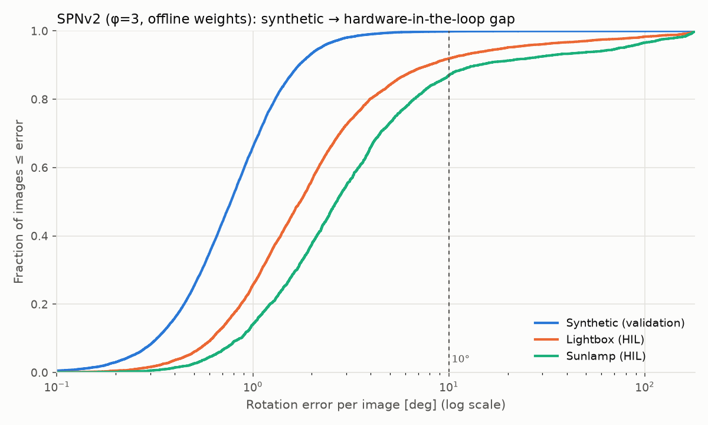
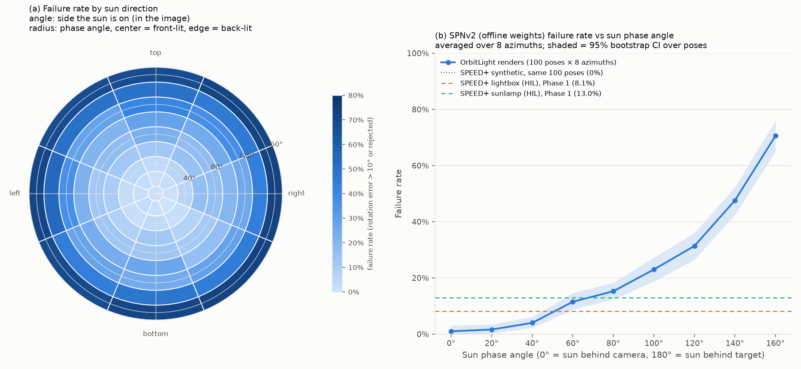
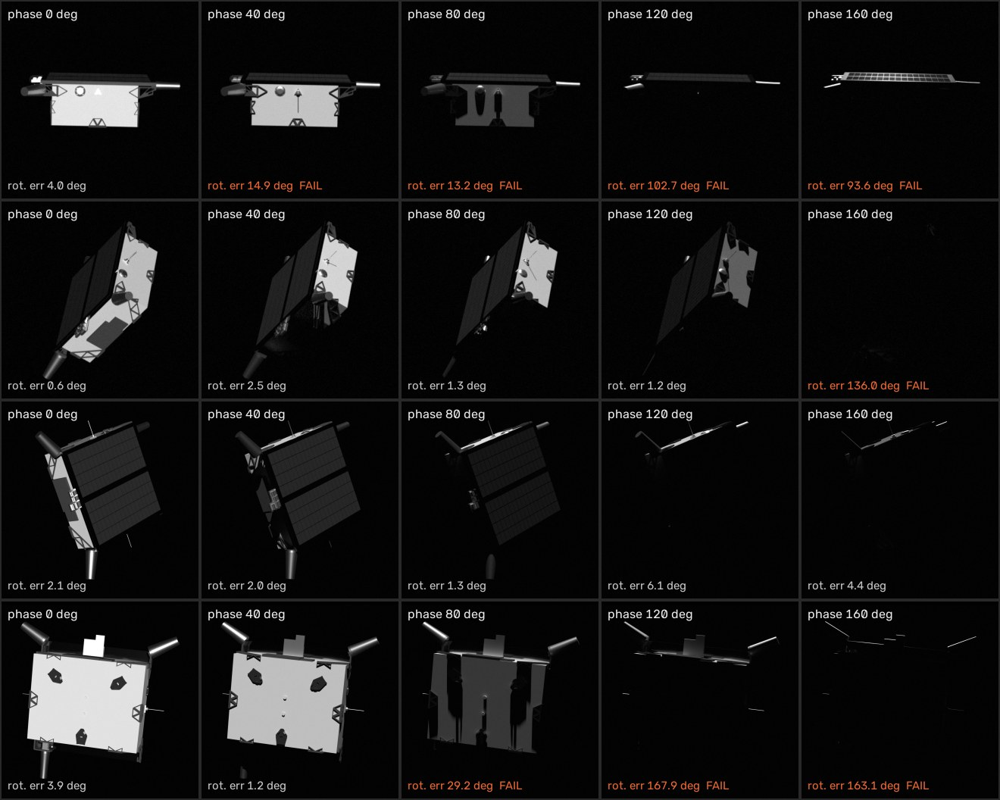
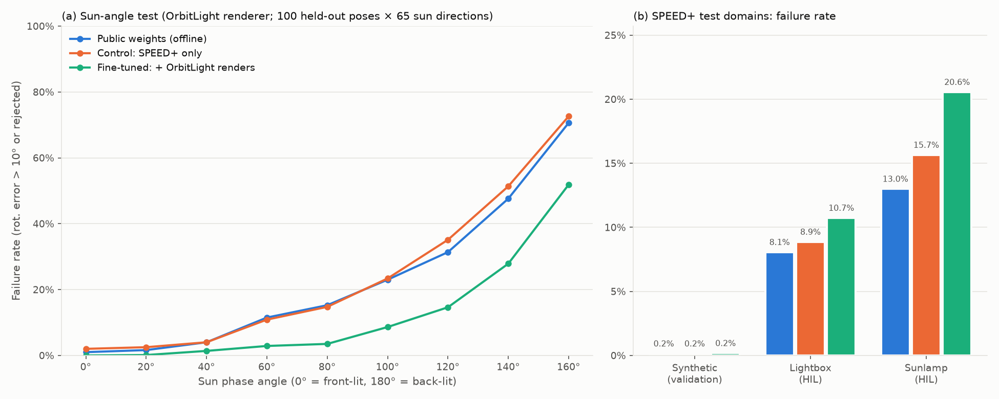

# OrbitLight

[English](README.md) | **한국어**

궤도 조명 조건을 재현하는 시뮬레이터로 위성 자세 추정(spacecraft pose estimation) 모델이
**어떤 조명에서 실패하는지 "실패 지도(failure map)"로 보여주고**, 그 실패를 줄이는 합성 데이터를 만드는 프로젝트.

> 상태: v0.1 — Phase 1(문제 재현), Phase 2(태양 각도 렌더링), Phase 3(실패 지도 + 재학습 실험) 완료.
> 재학습 결과는 **엇갈렸다**: 우리 렌더러 안에서는 역광 실패가 절반으로 줄었지만, 실물 조명 시험에서는 오히려 나빠졌다 (아래 Phase 3b).

## 요약

| | 결과 |
|---|---|
| 문제 재현 | SPNv2 공개 가중치: 합성 → 실물 조명(HIL) 종합 점수 5~8배 악화, 10장 중 1장꼴로 10° 이상 실패 |
| 실패 지도 | 태양 위상각 0° → 160°로 가면 실패율 1% → 71%. 핵심 변수는 위성 표면이 그림자에 덮인 비율 |
| 재학습 | 역광 렌더를 섞으면 같은 렌더러의 태양 실험 실패 26% → 14%, 하지만 실물 조명 HIL 실패는 9% → 11%, 16% → 21%로 증가 |
| 교훈 | 합성 데이터로 만든 실패 지도에서 좋아졌다고 실물에서 좋아지는 것은 아니다. **실물 조명 데이터로 꼭 확인해야 한다** |

## 문제 정의

- **Sim-to-real gap(시뮬레이션-현실 격차)**: 자세 추정 신경망은 합성 이미지로 학습하지만, 실제 궤도 이미지는
  대기 산란이 없어 명암 대비가 극단적이고 위성 표면이 거울처럼 반사돼 성능이 떨어진다.
- **조명 변화를 체계적으로 통제하지 않음**: 궤도 위치에 따라 태양 방향, 지구 반사광(albedo),
  식(eclipse)이 바뀌는데 기존 벤치마크는 이를 조건별로 나눠 평가하지 않는다.

## 방법

1. SPEED+ 데이터셋과 SPNv2 기준 모델로 합성 → HIL(Hardware-in-the-Loop, 실물 연동 시험) 도메인 성능 격차를 재현한다.
2. Blender로 태양 방향 각도를 바꿔 가며 Tango 위성 이미지를 렌더링한다.
3. 태양 각도별 오차를 시각화해 실패 지도를 만들고, 취약 구간을 보강하는 합성 데이터로 재학습한다.

## 결과

### Phase 1 — 문제 재현: SPNv2 기준 성능

SPNv2 저자 공개 가중치(φ=3, BN, 합성 이미지로만 학습)를 SPEED+ 세 도메인에서 평가했다.
지표는 SPEC2021 방식이다 (E_T: 위치 오차, E_R: 회전 오차, E_pose: 정규화한 종합 점수, 낮을수록 좋음).

| 도메인 | 이미지 수 | E_T [m] | E_R [°] | E_pose | 논문 E_pose | 회전 오차 중앙값 | 10° 넘는 비율 |
|---|---|---|---|---|---|---|---|
| 합성 검증셋 | 11,994 | 0.054 | 0.99 | 0.027 | – | 0.77° | 0.2% |
| lightbox (HIL) | 6,740 | 0.175 | 6.44 | 0.141 | 0.142 | 1.74° | 8.1% |
| sunlamp (HIL) | 2,791 | 0.225 | 10.87 | 0.227 | 0.230 | 2.67° | 13.0% |

- 논문 수치를 재현했다. 합성 → 실물 조명 환경으로 가면 종합 점수가 **5~8배 나빠진다**.
- 대부분의 이미지는 여전히 잘 맞추지만(중앙값 2~3°), **10장 중 1장꼴로 10° 이상 크게 틀린다**.



재현: `bash scripts/eval_spnv2_baseline.sh && python scripts/summarize_spnv2_eval.py && python scripts/plot_spnv2_error_cdf.py`

### Phase 2·3 — 태양 각도별 실패 지도

SPEED+ 합성 검증셋의 실제 자세 100개를 고정하고, **태양 방향만** 바꿔 가며 Blender(Cycles)로 6,500장을 렌더링한 뒤
같은 SPNv2 공개 가중치로 평가했다.

- 태양 방향 = **위상각**(phase angle, 위성에서 본 카메라 방향과 태양 방향 사이 각: 0° 정면 조명 ~ 180° 역광) 0~160°(20° 간격)
  × **방위각**(이미지에서 태양이 있는 쪽) 8방향.
- 위성 3D 모형은 SPIN 시뮬레이터의 Tango 모형(GPL-3.0, 저장소에 포함하지 않음, `scripts/download_tango_model.sh`).
  SPEED+ 카메라 내부 파라미터와 렌즈 왜곡을 그대로 쓰고, 흑백 변환과 센서 노이즈를 더해 SPEED+ 형식으로 저장한다.
- 실패 = 회전 오차 10° 초과 또는 자세 계산 거부 (Phase 1 표의 "10° 넘는 비율"과 같은 기준).



| 위상각 | 0° | 20° | 40° | 60° | 80° | 100° | 120° | 140° | 160° |
|---|---|---|---|---|---|---|---|---|---|
| 실패율 (offline) | 1.0% | 1.6% | 4.0% | 11.5% | 15.2% | 23.0% | 31.4% | 47.6% | 70.6% |
| 회전 오차 중앙값 | 1.51° | 1.61° | 1.87° | 2.14° | 2.49° | 3.19° | 4.45° | 8.74° | 48.3° |

- **조명이 옆·뒤로 돌수록 실패가 꾸준히 늘어난다.** 위상각 60°에서 이미 실물 조명 시험(lightbox 8.1%, sunlamp 13.0%) 수준이다.
- 태양이 이미지의 어느 쪽에 있는지(방위각)는 영향이 작다 (방위각별 22.9~28.5%).
- 핵심 변수는 **위성 표면이 그림자에 덮인 비율**이다. 같은 위상각 안에서도 어두운 쪽 절반의 실패율이 약 2배다 (140°: 33.5% → 61.8%).
- 실패의 43.5%는 90° 넘게 틀리는 **대칭 뒤집힘**이다. 조금 틀리는 게 아니라 아예 반대 방향으로 판단한다.
- sunlamp에 맞춰 보정한 ODR 가중치도 역광 실패를 줄이지 못했다 (160°에서 71.1%).



**한계**: 같은 자세의 SPEED+ 원본 이미지는 실패 0%, 회전 오차 중앙값 0.72°인데, 우리 렌더는 정면 조명에서도
1.0%, 1.51°로 약간 나쁘다. 렌더러(모형·재질) 차이가 있다는 뜻이라 **절대값보다 위상각에 따른 추세로 읽어야 한다.**
배경은 검은 우주뿐이고 지구 반사광(albedo)은 아직 없다 (v0.2).

재현:
```bash
bash scripts/download_tango_model.sh
python scripts/sunsweep.py jobs --run speedplus_sunsweep_v01 --n-poses 100 --sun-strength 4.0
python scripts/sunsweep.py render --run speedplus_sunsweep_v01   # RTX 4070 Ti SUPER에서 약 34분
python scripts/sunsweep.py post --run speedplus_sunsweep_v01
RUN=speedplus_sunsweep_v01 bash scripts/eval_spnv2_renders.sh
python scripts/failure_map.py --run speedplus_sunsweep_v01
```

### Phase 3b — 역광 렌더를 섞어 재학습 (미세조정)

실패 지도에서 찾은 약점(옆·뒤 조명, 그림자)을 보강하는 렌더를 만들어 SPNv2를 미세조정(fine-tuning)했다.
효과만 따로 보기 위해 **비교군**(같은 설정, SPEED+만)을 함께 학습했다.

- 학습용 렌더: SPEED+ **합성 학습셋** 자세 4,000개 × 무작위 태양 방향 2개 = 8,000장 (위상각 0~170° 균등, 방위각·태양 세기 무작위).
  평가에 쓰는 검증셋 자세와 겹치지 않는다.
- 두 모델 모두 공개 offline 가중치에서 시작, 6에폭, 학습률 1e-4, 배치 4, GPU 1장.
  - 비교군: SPEED+ 합성 학습 이미지 16,000장
  - 본 실험: SPEED+ 8,000장 + OrbitLight 렌더 7,500장
- 원래 SPNv2 학습의 스타일 증강(texture randomization)은 스타일 이미지가 공개돼 있지 않아 껐다. 나머지 증강은 그대로.
- 모델 선택 편향을 없애기 위해 둘 다 마지막 에폭 가중치로 평가했다. 조건마다 학습은 1회씩이다.



| 모델 | lightbox E_pose | sunlamp E_pose | lightbox 실패 | sunlamp 실패 | 태양 실험 실패 0~40° | 60~100° | 120~160° |
|---|---|---|---|---|---|---|---|
| 공개 가중치 (offline) | 0.141 | 0.227 | 8.1% | 13.0% | 2.7% | 16.6% | 49.9% |
| 비교군: SPEED+만 | 0.164 | 0.278 | 8.9% | 15.7% | 3.2% | 16.3% | 53.0% |
| 본 실험: + OrbitLight 렌더 | 0.211 | 0.353 | **10.7%** | **20.6%** | **0.7%** | **5.0%** | **31.5%** |

(합성 검증셋은 세 모델 모두 실패 0.2%, E_pose 0.027~0.031)

무엇을 알았나:
- **우리 렌더러 안에서는 크게 좋아졌다.** 태양 실험 전체 실패율 26.4% → 13.6%, 위상각 60~100°에서는 16.3% → 5.0%.
- **실물 조명 HIL에서는 나빠졌다.** 비교군 대비 lightbox 8.9% → 10.7%, sunlamp 15.7% → 20.6%.
  같은 이미지로 짝지어 비교한 McNemar 검정에서 둘 다 우연으로 보기 어렵다 (p = 1.8e-8, 1.2e-13).
- 정면 조명(위상각 0°)에서도 좋아졌다 (회전 오차 중앙값 1.46° → 1.11°). 조명과 상관없는 부분이므로,
  태양 실험 개선의 일부는 **역광을 배운 것이 아니라 우리 렌더러의 모습에 적응한 것**으로 보인다.
- 스타일 증강 없이 SPEED+만으로 더 학습해도(비교군) 공개 가중치보다 HIL이 조금 나빠졌다.
  원래 학습의 스타일 증강이 실물 조명 강건성에 중요하다는 뜻으로 보인다.

결론: **합성 실패 지도에서의 개선이 실물 개선을 보장하지 않는다.** 지금 렌더는 실물 조명으로 옮겨 가지 않는다.
실패 지도는 약점을 찾는 데는 유용하지만, 개선 주장은 반드시 실물 조명 데이터(HIL)로 확인해야 한다.

가능한 원인과 다음 실험 (아직 검증 안 함):
- 렌더러 차이: 재질·텍스처를 한 가지로 고정했다 → 렌더에 재질·텍스처 무작위화(domain randomization)
- 형상 차이: SPIN 모형과 SPEED+ 키포인트가 일부 18~25mm 다르다 → 렌더 라벨이 조금 어긋날 수 있음
- 거의 안 보이는 역광 이미지가 학습 신호를 흐릴 수 있다 → 렌더 비율·위상각 분포 조절
- 학습 1회씩이라 학습 간 편차를 아직 모른다 → 반복 학습

재현:
```bash
python scripts/sunsweep.py jobs --run speedplus_trainrender_v01 --pose-source synthetic/train.json \
    --n-poses 4000 --random-per-pose 2 --phase-max 170 --strength-range 3,5 --color-depth 8 --seed 1
python scripts/sunsweep.py render --run speedplus_trainrender_v01   # 약 1.5시간
python scripts/sunsweep.py post --run speedplus_trainrender_v01
python scripts/build_finetune_set.py --name speedplus_ftctrl_v01 --speed-n 16000 --val-n 500
python scripts/build_finetune_set.py --name speedplus_ft_v01 --renders speedplus_trainrender_v01 --speed-n 8000 --val-n 500
DATA=speedplus_ftctrl_v01 EXP=ftctrl_v01 BATCH=4 bash scripts/finetune_spnv2.sh   # 약 80분
DATA=speedplus_ft_v01 EXP=ft_v01 BATCH=4 bash scripts/finetune_spnv2.sh
WEIGHTS="ftctrl_v01:final ft_v01:final" bash scripts/eval_spnv2_baseline.sh
RUN=speedplus_sunsweep_v01 WEIGHTS="ftctrl_v01:final ft_v01:final" bash scripts/eval_spnv2_renders.sh
python scripts/compare_finetune.py --weights offline ftctrl_v01:final ft_v01:final
```

실험 기록은 [`experiments/LOG.md`](experiments/LOG.md) 참고 (한국어).

## 환경 설정

```bash
conda create -n orbitlight python=3.11
conda activate orbitlight
pip install -r requirements.txt   # PyTorch는 CUDA 13.0(cu130) 빌드로 고정
pip install -e . --no-deps
python scripts/check_env.py
```

- Blender 5.2는 공식 tarball을 `~/apps/`에 풀어서 쓴다 (`scripts/check_env.py`가 경로를 확인).
- SPNv2는 `third_party/spnv2`에 클론하고 `third_party/patches/`의 패치를 적용한다 ([`third_party/README.md`](third_party/README.md)).
- 확인한 환경: Ubuntu 22.04, RTX 4070 Ti SUPER (16GB), Python 3.11, PyTorch 2.14 (cu130).

## 폴더 구조

```
data/         데이터셋 (git 제외)
outputs/      가중치, 렌더링, 그래프 (git 제외)
third_party/  SPNv2 등 외부 코드 (git 제외, 각자 클론) + 패치
src/orbitlight/
  render/     Blender 조명 렌더링, 후처리
  eval/       평가 결과 읽기
  orbit/      (v0.2) 궤도·조명 계산
scripts/      실행 스크립트
experiments/  실험 기록
docs/figures/ README 그림
```

## 데이터·코드 출처와 라이선스

- 이 저장소에는 라이선스 파일이 없다 (모든 권리 보유). 데이터셋·가중치·3D 모형·렌더 이미지는 포함하지 않는다.
- SPEED+ (Park et al., Stanford SLAB) — CC BY-NC-SA 4.0 — https://purl.stanford.edu/wv398fc4383
- SPNv2 (Park & D'Amico) — MIT — https://github.com/tpark94/spnv2
- SPIN 시뮬레이터 Tango 3D 모형 (vpulab) — GPL-3.0 — https://github.com/vpulab/SPIN
- README 그림의 렌더 예시는 위 SPIN 모형과 SPEED+ 자세 라벨로 만들었다.
