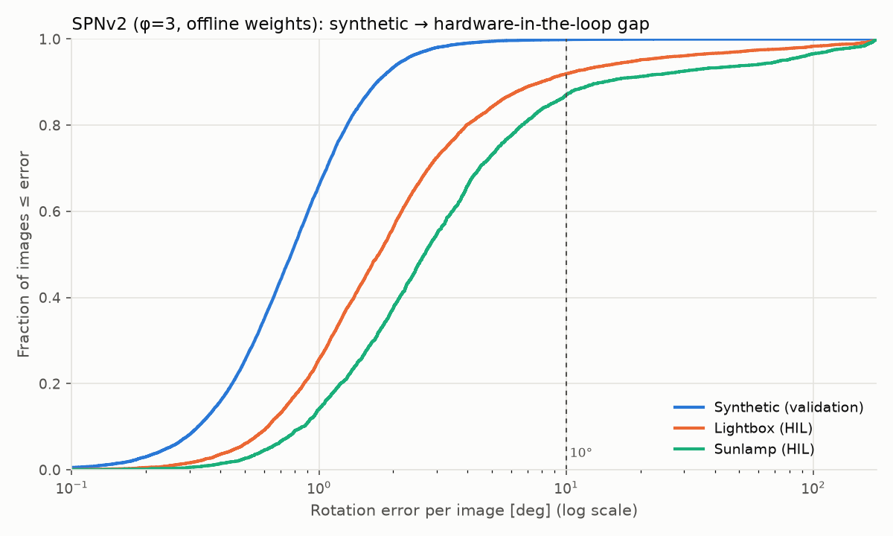
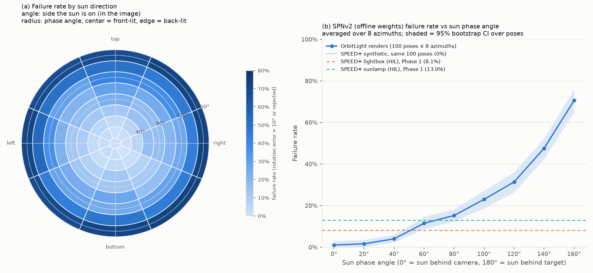
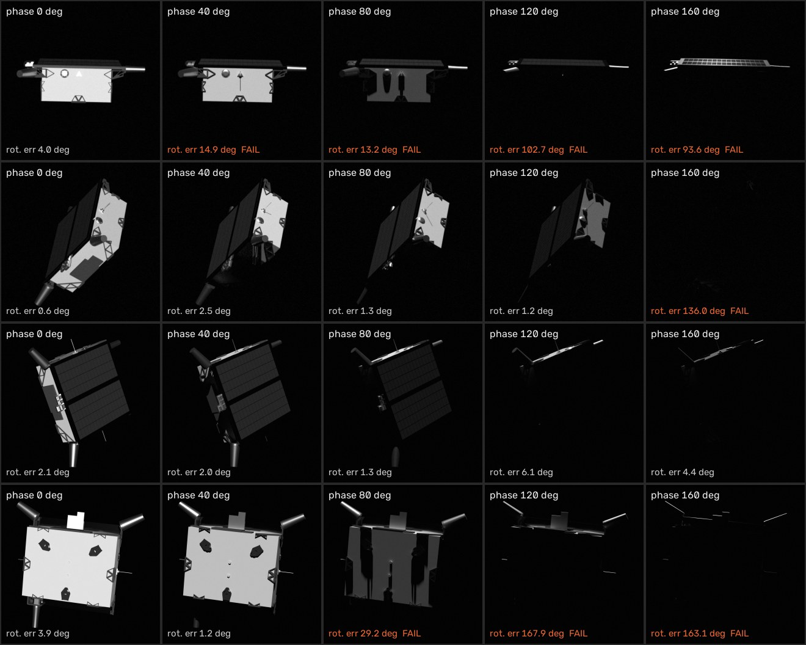
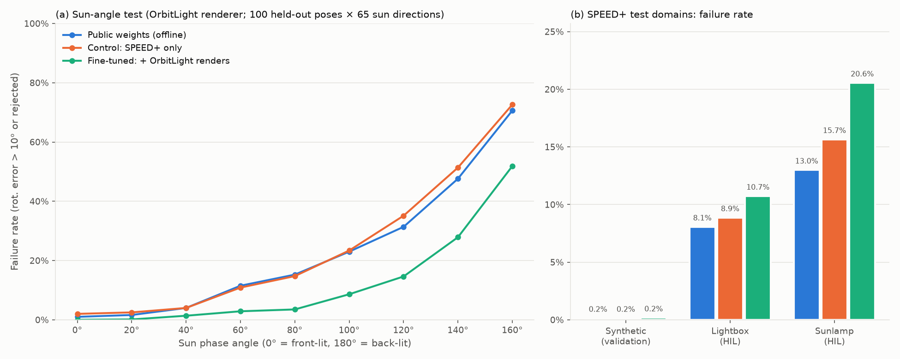

# OrbitLight

**English** | [한국어](README.ko.md)

A lighting simulator for orbital scenes that maps **under which sun conditions a spacecraft pose estimation network fails**
(a "failure map"), and tests whether targeted synthetic data can reduce those failures.

> Status: v0.1 — Phase 1 (reproduce the problem), Phase 2 (sun-angle rendering) and Phase 3 (failure map + retraining experiment) done.
> The retraining result is **mixed**: back-lit failures halved inside our own renderer, but performance on real-lighting
> hardware-in-the-loop images got worse (Phase 3b below).

## TL;DR

| | Result |
|---|---|
| Reproduce the gap | SPNv2 public weights: pose score is 5–8× worse on real-lighting (HIL) images than on synthetic; ~1 in 10 HIL images is off by >10° |
| Failure map | As the sun phase angle goes from 0° to 160°, the failure rate rises from 1% to 71%. The key variable is how much of the satellite is in shadow |
| Retraining | Mixing in back-lit renders cuts failures on the same-renderer sun-angle test from 26% to 14%, but raises HIL failures from 9% to 11% (lightbox) and 16% to 21% (sunlamp) |
| Lesson | An improvement on a synthetic failure map does not imply a real-world improvement. **Claims must be checked on real-lighting data** |

## Problem

- **Sim-to-real gap**: pose estimation networks are trained on synthetic images, but real orbital images have extreme
  contrast (no atmospheric scattering) and mirror-like surfaces, so accuracy drops.
- **Lighting is not controlled systematically**: sun direction, Earth albedo and eclipse change along the orbit,
  but existing benchmarks do not break results down by lighting condition.

## Approach

1. Reproduce the synthetic → HIL (Hardware-in-the-Loop) performance gap with the SPEED+ dataset and the SPNv2 baseline.
2. Render the Tango satellite in Blender while sweeping only the sun direction.
3. Plot error vs. sun angle (failure map), then retrain with synthetic data that targets the weak conditions.

## Results

### Phase 1 — Reproducing the gap: SPNv2 baseline

The authors' public SPNv2 weights (φ=3, BN, trained on synthetic images only) evaluated on the three SPEED+ domains.
Metrics follow SPEC2021 (E_T: translation error, E_R: rotation error, E_pose: normalized combined score, lower is better).

| Domain | Images | E_T [m] | E_R [°] | E_pose | Paper E_pose | Median rot. error | Share > 10° |
|---|---|---|---|---|---|---|---|
| Synthetic validation | 11,994 | 0.054 | 0.99 | 0.027 | – | 0.77° | 0.2% |
| lightbox (HIL) | 6,740 | 0.175 | 6.44 | 0.141 | 0.142 | 1.74° | 8.1% |
| sunlamp (HIL) | 2,791 | 0.225 | 10.87 | 0.227 | 0.230 | 2.67° | 13.0% |

- Paper numbers reproduced. Moving from synthetic to real lighting makes the score **5–8× worse**.
- Most images are still accurate (median 2–3°), but **about 1 in 10 is off by more than 10°**.



Reproduce: `bash scripts/eval_spnv2_baseline.sh && python scripts/summarize_spnv2_eval.py && python scripts/plot_spnv2_error_cdf.py`

### Phase 2·3 — Failure map over sun angle

100 real poses from the SPEED+ synthetic validation set were fixed and **only the sun direction** was varied.
6,500 images were rendered with Blender (Cycles) and evaluated with the same public SPNv2 weights.

- Sun direction = **phase angle** (angle between the camera and sun directions as seen from the satellite: 0° front-lit … 180° back-lit),
  0–160° in 20° steps, × **azimuth** (which side of the image the sun is on), 8 directions.
- Satellite model: the Tango model from the SPIN simulator (GPL-3.0, not included in this repo, see `scripts/download_tango_model.sh`).
  SPEED+ camera intrinsics and lens distortion are reproduced, then images are converted to grayscale with sensor noise and saved in SPEED+ format.
- Failure = rotation error > 10° or pose rejected (same criterion as "Share > 10°" above).



| Phase angle | 0° | 20° | 40° | 60° | 80° | 100° | 120° | 140° | 160° |
|---|---|---|---|---|---|---|---|---|---|
| Failure rate (offline) | 1.0% | 1.6% | 4.0% | 11.5% | 15.2% | 23.0% | 31.4% | 47.6% | 70.6% |
| Median rot. error | 1.51° | 1.61° | 1.87° | 2.14° | 2.49° | 3.19° | 4.45° | 8.74° | 48.3° |

- **Failures rise steadily as the light moves to the side and back.** At 60° the rate already matches the real-lighting tests (lightbox 8.1%, sunlamp 13.0%).
- Which side of the image the sun is on (azimuth) matters little (22.9–28.5% by azimuth).
- The key variable is **the fraction of the satellite surface in shadow**. Within the same phase angle, the darker half fails about twice as often (140°: 33.5% → 61.8%).
- 43.5% of failures are **symmetric flips** with errors above 90°: the network picks the opposite orientation, not a slightly wrong one.
- The ODR weights (adapted to sunlamp) do not reduce back-lit failures either (71.1% at 160°).



**Limitations**: the original SPEED+ images of the same poses have 0% failures and a 0.72° median error, while our renders
are slightly worse even when front-lit (1.0%, 1.51°). There is a renderer (model/material) gap, so **read the trend over phase
angle rather than the absolute values.** The background is black space only; Earth albedo is not modeled yet (v0.2).

Reproduce:
```bash
bash scripts/download_tango_model.sh
python scripts/sunsweep.py jobs --run speedplus_sunsweep_v01 --n-poses 100 --sun-strength 4.0
python scripts/sunsweep.py render --run speedplus_sunsweep_v01   # ~34 min on an RTX 4070 Ti SUPER
python scripts/sunsweep.py post --run speedplus_sunsweep_v01
RUN=speedplus_sunsweep_v01 bash scripts/eval_spnv2_renders.sh
python scripts/failure_map.py --run speedplus_sunsweep_v01
```

### Phase 3b — Retraining with back-lit renders (fine-tuning)

Renders targeting the weaknesses found above (side and back lighting, shadows) were used to fine-tune SPNv2.
A **control** model with identical settings but SPEED+ images only was trained to isolate the effect of the renders.

- Training renders: 4,000 poses from the SPEED+ **synthetic train set** × 2 random sun directions = 8,000 images
  (phase angle uniform in 0–170°, random azimuth and sun strength). No overlap with the evaluation poses.
- Both models start from the public offline weights: 6 epochs, learning rate 1e-4, batch 4, single GPU.
  - Control: 16,000 SPEED+ synthetic training images
  - Experiment: 8,000 SPEED+ images + 7,500 OrbitLight renders
- SPNv2's original style augmentation (texture randomization) is off because its style images are not public. All other augmentations are unchanged.
- Both are evaluated at the final epoch to avoid model-selection bias. One training run per condition.



| Model | lightbox E_pose | sunlamp E_pose | lightbox fail | sunlamp fail | Sun-angle test fail 0–40° | 60–100° | 120–160° |
|---|---|---|---|---|---|---|---|
| Public weights (offline) | 0.141 | 0.227 | 8.1% | 13.0% | 2.7% | 16.6% | 49.9% |
| Control: SPEED+ only | 0.164 | 0.278 | 8.9% | 15.7% | 3.2% | 16.3% | 53.0% |
| Experiment: + OrbitLight renders | 0.211 | 0.353 | **10.7%** | **20.6%** | **0.7%** | **5.0%** | **31.5%** |

(On the synthetic validation set all three models fail 0.2% of the time, E_pose 0.027–0.031.)

What we learned:
- **Large gains inside our own renderer.** Overall sun-angle test failures 26.4% → 13.6%; at 60–100° phase, 16.3% → 5.0%.
- **Worse on real-lighting HIL images.** Versus the control: lightbox 8.9% → 10.7%, sunlamp 15.7% → 20.6%.
  A paired McNemar test on the same images rules out chance for both (p = 1.8e-8 and 1.2e-13).
- The model also improved under front lighting (phase 0°: median rotation error 1.46° → 1.11°). That has nothing to do with
  lighting, so part of the sun-angle gain looks like **adaptation to our renderer's appearance rather than learning to handle back-lighting**.
- Training further on SPEED+ alone without style augmentation (control) already made HIL slightly worse than the public weights,
  suggesting the original style augmentation matters for robustness to real lighting.

Conclusion: **an improvement on a synthetic failure map does not guarantee a real-world improvement.** The current renders do not
transfer to real lighting. The failure map is useful for finding weaknesses, but any improvement claim has to be confirmed on real-lighting (HIL) data.

Possible causes and next experiments (not yet tested):
- Renderer gap: one fixed material/texture setup → randomize materials and textures in the renders (domain randomization)
- Geometry gap: some SPIN model keypoints differ from the SPEED+ keypoints by 18–25 mm → render labels may be slightly off
- Nearly invisible back-lit images may dilute the training signal → tune the render share and phase-angle distribution
- One run per condition, so run-to-run variance is unknown → repeat training

Reproduce:
```bash
python scripts/sunsweep.py jobs --run speedplus_trainrender_v01 --pose-source synthetic/train.json \
    --n-poses 4000 --random-per-pose 2 --phase-max 170 --strength-range 3,5 --color-depth 8 --seed 1
python scripts/sunsweep.py render --run speedplus_trainrender_v01   # ~1.5 h
python scripts/sunsweep.py post --run speedplus_trainrender_v01
python scripts/build_finetune_set.py --name speedplus_ftctrl_v01 --speed-n 16000 --val-n 500
python scripts/build_finetune_set.py --name speedplus_ft_v01 --renders speedplus_trainrender_v01 --speed-n 8000 --val-n 500
DATA=speedplus_ftctrl_v01 EXP=ftctrl_v01 BATCH=4 bash scripts/finetune_spnv2.sh   # ~80 min
DATA=speedplus_ft_v01 EXP=ft_v01 BATCH=4 bash scripts/finetune_spnv2.sh
WEIGHTS="ftctrl_v01:final ft_v01:final" bash scripts/eval_spnv2_baseline.sh
RUN=speedplus_sunsweep_v01 WEIGHTS="ftctrl_v01:final ft_v01:final" bash scripts/eval_spnv2_renders.sh
python scripts/compare_finetune.py --weights offline ftctrl_v01:final ft_v01:final
```

The full experiment log is in [`experiments/LOG.md`](experiments/LOG.md) (Korean).

## Setup

```bash
conda create -n orbitlight python=3.11
conda activate orbitlight
pip install -r requirements.txt   # PyTorch pinned to the CUDA 13.0 (cu130) build
pip install -e . --no-deps
python scripts/check_env.py
```

- Blender 5.2: unpack the official tarball into `~/apps/` (`scripts/check_env.py` checks the path).
- SPNv2: clone into `third_party/spnv2` and apply the patches in `third_party/patches/` (see [`third_party/README.md`](third_party/README.md)).
- Tested on Ubuntu 22.04, RTX 4070 Ti SUPER (16 GB), Python 3.11, PyTorch 2.14 (cu130).

## Layout

```
data/         datasets (not in git)
outputs/      weights, renders, plots (not in git)
third_party/  external code such as SPNv2 (not in git, clone yourself) + patches
src/orbitlight/
  render/     Blender lighting renders, post-processing
  eval/       reading evaluation results
  orbit/      (v0.2) orbit and lighting computation
scripts/      entry-point scripts
experiments/  experiment log
docs/figures/ README figures
```

## Data, code and licenses

- This repository has no license file (all rights reserved). Datasets, weights, the 3D model and rendered images are not included.
- SPEED+ (Park et al., Stanford SLAB) — CC BY-NC-SA 4.0 — https://purl.stanford.edu/wv398fc4383
- SPNv2 (Park & D'Amico) — MIT — https://github.com/tpark94/spnv2
- SPIN simulator Tango 3D model (vpulab) — GPL-3.0 — https://github.com/vpulab/SPIN
- The render examples in the README figures were made with the SPIN model above and SPEED+ pose labels.
